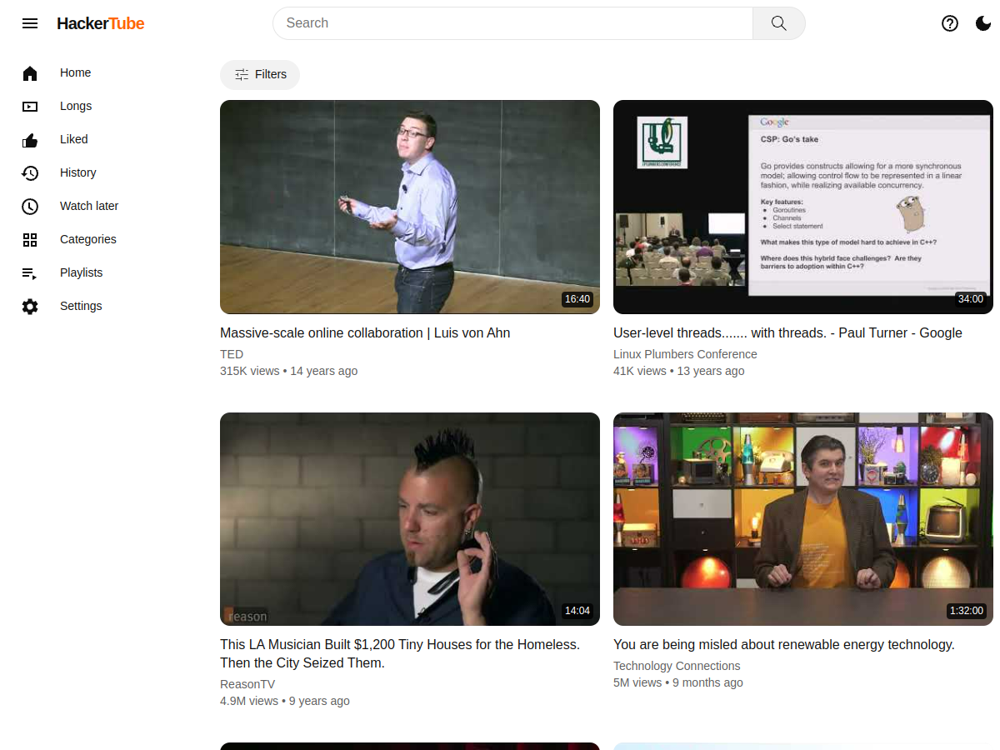
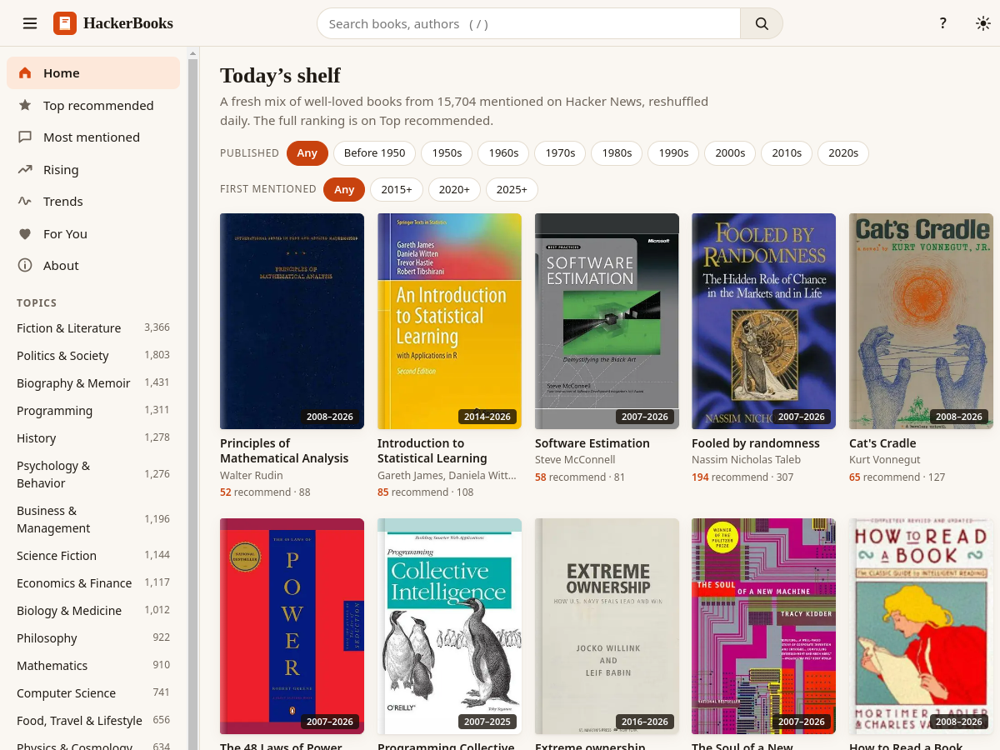

# HackerTube、Hacker Books 与 Hacker Podcasts：发现视频、书籍和播客

## HackerTube

[HackerTube](https://hackertube.org/) 是一个用于发现和浏览 YouTube 视频的网站。首页提供搜索和筛选入口，也可以按分类浏览；侧边栏还包括长视频、观看历史、稍后观看和播放列表等功能。适合用来探索技术演讲、课程和其他长视频内容。

## Hacker Books

[Hacker Books](https://hackerbooks.org/) 汇集 Hacker News 评论中提到的书籍，并按推荐情况展示。可以搜索书名或作者，按主题浏览，也能依据出版年代、首次在 Hacker News 被提及的时间筛选；首页提供今日书架、热门推荐和趋势等入口。适合从技术社区的讨论中发现待读书目。

## Hacker Podcasts

[Hacker Podcasts](https://www.hackerpodcasts.org/) 汇总 Hacker News 评论中反复被推荐的播客。首页按长期推荐、近期上升和经典节目等方式展示播客，也可以搜索节目或按主题浏览，适合从社区讨论中寻找新的收听内容。

这三个网站分别聚合视频、书籍和播客资源。可以先按主题或关键词筛选，再根据自己的兴趣继续探索。

